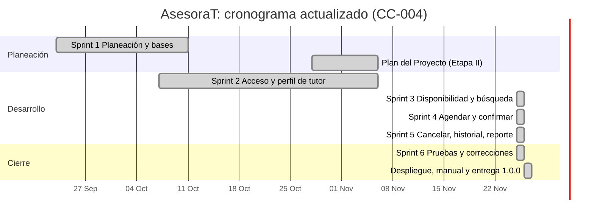

# Backlog y plan de sprints

Cronograma actualizado el 25 nov 2026 (ver CC-004 en la bitácora de cambios) para cumplir la fecha de entrega final de la consigna: **26 nov 2026**. La línea base de la Etapa II terminaba el 4 dic (CC-003). HU-08 y HU-10 se presentan como mejoras de la versión 1.1.
El tablero Kanban se lleva en **GitHub Projects** con las columnas: Por hacer · En progreso · En revisión · Terminado.

| Sprint | Fechas planeadas (CC-003) | Fechas reales (CC-004) | Objetivo | Elementos | Estado |
|---|---|---|---|---|---|
| 1 | 23 sep a 11 oct | 23 sep a 11 oct | Planeación y bases del proyecto | Plan de calidad, requerimientos, historias de usuario, diagramas, repositorio, modelo de datos, pantallas iniciales | ✅ Terminado |
| 2 | 7 oct a 6 nov | 7 oct a 6 nov | Acceso y perfil de tutor | HU-01, HU-02, conexión a base de datos, búsqueda desde la BD (adelanto de HU-04) | ✅ Terminado |
| 3 | 9 a 13 nov | 25 nov | Disponibilidad y búsqueda | HU-03, completar HU-04 | ✅ Terminado |
| 4 | 16 a 20 nov | 25 nov | Agendar asesorías | HU-05, HU-06 | ✅ Terminado |
| 5 | 23 a 27 nov | 25 nov | Cancelación, historial y reporte | HU-07, HU-09, HU-11 | ✅ Terminado |
| 6 | 30 nov a 4 dic | 25 a 26 nov | Pruebas, correcciones y entrega | Bitácora de pruebas, corrección de defectos, despliegue en Vercel y Neon, manual de usuario, versión 1.0.0 | ✅ Terminado |
| v1.1 | Después del semestre | Después del semestre | Mejoras futuras | HU-08 avisos por correo, HU-10 calificación, pruebas con usuarios externos y cuestionario SUS | Mejora futura |

## Cronograma (Gantt)

## Backlog priorizado

| # | ID | Elemento | Prioridad | Puntos | Sprint | Estado |
|---|---|---|---|---|---|---|
| 1 | HU-01 | Registro e inicio de sesión con correo institucional | Alta | 5 | 2 | ✅ Terminada |
| 2 | HU-02 | Tutor registra sus materias | Alta | 3 | 2 | ✅ Terminada |
| 3 | HU-03 | Tutor registra su disponibilidad | Alta | 5 | 3 | ✅ Terminada |
| 4 | HU-04 | Búsqueda de asesorías con filtros | Alta | 5 | 3 | ✅ Terminada |
| 5 | HU-05 | Agendar asesoría sin empalmes | Alta | 8 | 4 | ✅ Terminada |
| 6 | HU-06 | Confirmar o rechazar solicitudes | Alta | 3 | 4 | ✅ Terminada |
| 7 | HU-07 | Cancelar asesoría | Media | 3 | 5 | ✅ Terminada |
| 8 | HU-09 | Historial de asesorías | Media | 3 | 5 | ✅ Terminada |
| 9 | HU-11 | Reporte de horas para coordinación | Media | 5 | 5 | ✅ Terminada |
| 10 | HU-08 | Avisos por correo | Media | 5 | v1.1 | Mejora futura |
| 11 | HU-10 | Calificar asesoría | Baja | 3 | v1.1 | Mejora futura |

**Versión 1.0.0:** 9 historias, 40 de 40 puntos comprometidos (100 %). Las mejoras de la versión 1.1 suman 8 puntos.
