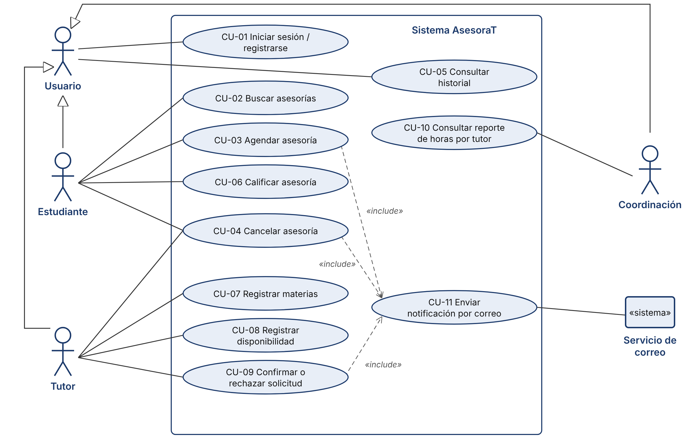
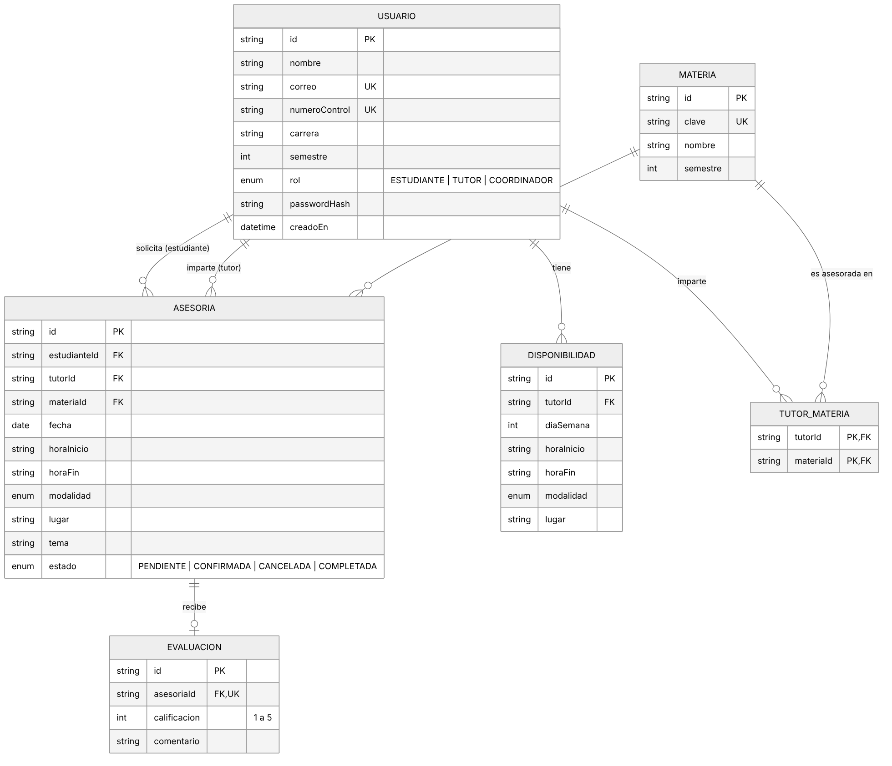
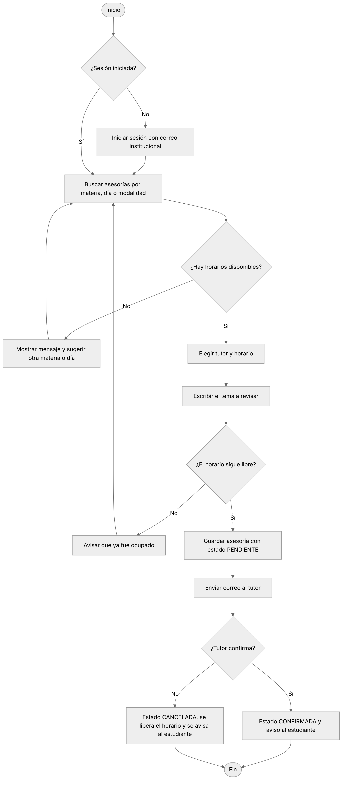
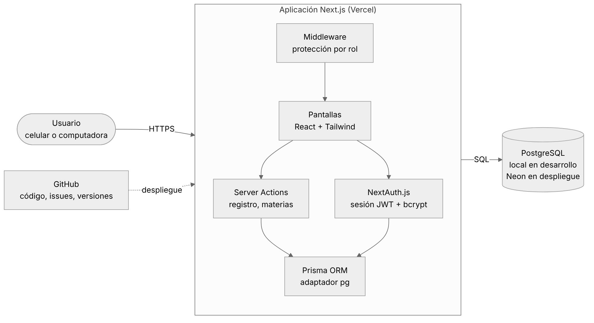
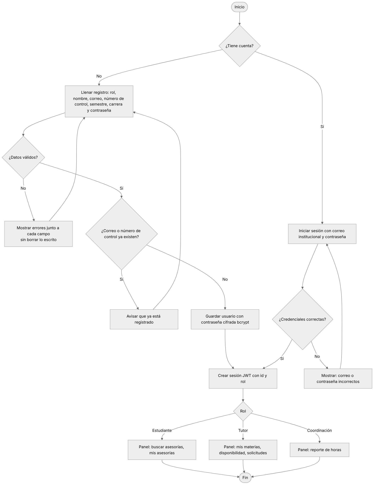

# Diagramas

| Diagrama | Fuente | Imagen |
|---|---|---|
| Casos de uso | [casos-de-uso.svg](diagramas/casos-de-uso.svg) |  |
| Modelo de base de datos | [modelo-bd.mmd](diagramas/modelo-bd.mmd) |  |
| Flujo para agendar | [flujo-agendar.mmd](diagramas/flujo-agendar.mmd) |  |
| Arquitectura (Sprint 2) | [arquitectura.mmd](diagramas/arquitectura.mmd) |  |
| Flujo de registro e inicio de sesión (Sprint 2) | [flujo-acceso.mmd](diagramas/flujo-acceso.mmd) |  |
